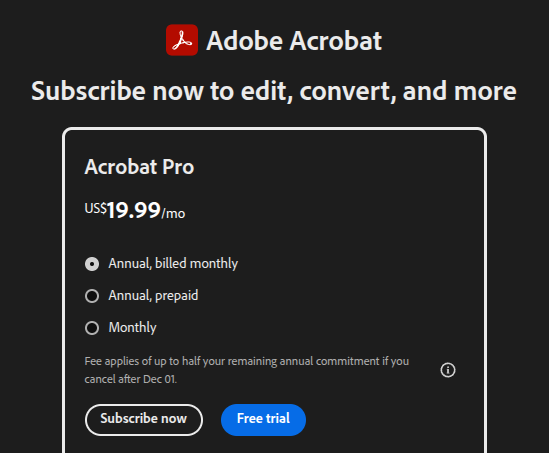
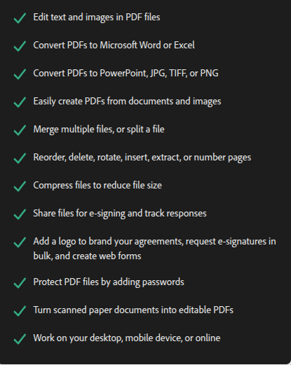

# PDF Editor

I am a huge fan of paying for subscriptions to software that I'm forced to use because of a weird monopoly a particular company has on an open format. I was sitting here working on the paperwork to enroll my child into daycare when I went to highlight one wimpy line of text. 

   

Ah, a paywall! For a feature as rich and robust as highlighting text, I should have known this action would have been behind a $20/month subscription. For a moment I was afraid they would have put the table-stakes features behind the sub. 



Oh, okay. Well instead of doing that or searching the web for an alternative utility I'll just burn some tokens and make my own. 

---

A fast, private PDF editor that runs in your browser. It works entirely offline: nothing is uploaded and there are no accounts. It's built on [MuPDF](https://mupdf.com/) (compiled to WebAssembly), which runs in a Web Worker so the UI never freezes.

## Run it

```bash
npm install
npm start          # builds, then serves at http://localhost:5199 and opens it
# or, while hacking on the code:
npm run dev
```

**Install as an app (Chrome/Chromium):** open the page, then use the install icon in the address bar. Once installed:
- it opens in its own window and works offline;
- it shows up in "Open with…" for PDFs in the Files app;
- **Ctrl+S saves straight back to the original file.** Firefox can't do this and downloads a copy instead.

## Features

| | |
|---|---|
| **Edit existing text** (E) | Click a line to rewrite it. The edit is written into the page content, not layered on top, so copy/paste and search see the new text and the old text is gone. Fonts are matched to the original (the document's own embedded TrueType font when it has the glyphs, otherwise the closest Helvetica/Times/Courier with matching weight). |
| **Add text** (T) | Click and type. Double-click a text box later to change it. Font, size and color are in the side panel. |
| **Highlight / underline / strikethrough** (H U K) | Drag across text. Or select text with the Select tool and use the popup. |
| **Comments** (N) | Sticky notes, plus a comment on any annotation. All comments are listed in the side panel. |
| **Shapes** (R O L A G P) | Rectangle, ellipse, line, arrow, polygon, freehand pen. Stroke, fill, thickness and opacity can be changed. |
| **Signature** (S) | Draw, type, or upload one (with optional white-background removal). Signatures are remembered on this device. |
| **Images** (I) | Insert a PNG or JPEG. |
| **Whiteout** (W) | Cover content with white. This is cosmetic; the content is still there underneath. |
| **Redaction** (X, then Apply) | Removes the text, images and graphics underneath for real. Verified: removed text doesn't survive anywhere in the saved file. |
| **Forms** | Fill text fields, checkboxes, radio buttons and dropdowns. |
| **Pages** | Thumbnails. Drag to reorder. Rotate, delete, insert a blank page, insert another PDF (merge), extract pages to a new PDF. Ctrl/Shift-click selects several pages. |
| **Search, copy, zoom** | Ctrl+F, Ctrl+C, Ctrl+wheel. |
| **Undo/redo** | Covers everything, including page operations, redactions and text edits, and keeps working after saving. |
| **Flatten on export** | Ctrl+Shift+S burns annotations and/or form fields into the page. |

Press **?** in the app for all keyboard shortcuts.

## Limitations

- Text editing works line by line. A paragraph doesn't re-flow, so a much longer line can run past the margin.
- Scanned pages are images, so their text can't be edited (OCR isn't included).
- Text in non-Latin scripts falls back to the standard fonts, which only cover Latin.

## Development

```bash
npm test           # engine tests (Vitest, runs MuPDF in Node)
npm run typecheck
```

- `src/engine/engine.ts`: every document operation. It runs in the worker and in tests.
- `src/engine/worker.ts`, `client.ts`: Comlink bridge and the render scheduler.
- `src/viewer/`: virtualized page list, page rendering, form fields.
- `src/tools/`: pointer interaction for every tool, inline editors.
- `src/panels/`: toolbar, thumbnails, properties/comments, dialogs.

The MuPDF document is the single source of truth, and each edit is one MuPDF journal step (that's how undo works). Saving never writes the live document, because that breaks MuPDF's undo. Instead, saving replays the logged edits onto a fresh copy of the original file and garbage-collects it.

**License note:** MuPDF is AGPL-3.0. 
